```console
$ whoami
NoctV — Yerevan, Armenia. I build things that live at night.

$ cat ./now.txt
NoctV · a night-sky workspace: tasks, goals, journal, knowledge, money, focus
Noct  · a voice assistant on Claude that runs my PC and remembers what matters

$ cat ./rules.txt
1. Build it beautiful.  2. Ship it fast.  3. Never stop.
```

<table>
<tr>
<td width="50%" valign="top">

#### ◎ [NoctV](https://github.com/NoctV/noctv-releases)
The whole system: tasks, goals, an encrypted journal, a knowledge base, finances, a plan, focus — and Noct inside.

[⬇ Windows](https://github.com/NoctV/noctv-releases/releases/latest) · [🌐 Web & phone](https://noctv-os.vercel.app)

</td>
<td width="50%" valign="top">

#### ◎ [Noct](https://github.com/NoctV/noct-releases)
The assistant on its own: voice control of Windows, own commands, memory.

[⬇ Get Noct](https://github.com/NoctV/noct-releases/releases/latest)

</td>
</tr>
</table>

<p align="center">

</p>

<picture>
  <source media="(prefers-color-scheme: dark)" srcset="https://raw.githubusercontent.com/NoctV/NoctV/output/snake-dark.svg" />
  
</picture>
