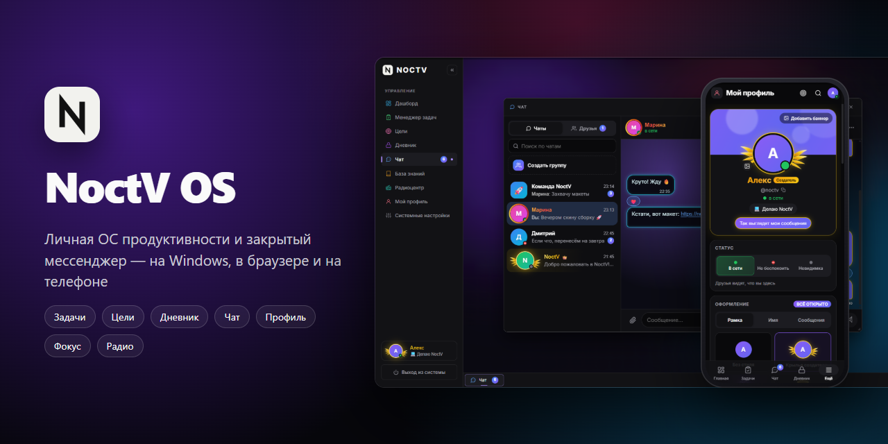

<div align="center">



<br/>






</div>

<table>
<tr>
<td width="42%" align="center">

</td>
<td width="58%">

```js
const noctv = {
  realm:     "Yerevan, Armenia",
  forging:   "NoctV OS — a personal OS & private messenger",
  weapons:   ["JavaScript", "React", "Electron", "Supabase"],
  rule:      "Build it beautiful. Ship it fast.",
  motto:     "In this world, nothing is more important than winning.",
};
```

> *🖤 Night is my kingdom, code is my sword.*

</td>
</tr>
</table>

<div align="center">







</div>

<table>
<tr>
<td>

### 🏰 [NoctV OS](https://github.com/NoctV/noctv-os-releases)

**A personal productivity OS and a private messenger** — tasks, goals, an encrypted journal, a knowledge base, chats with friends, profiles with dark-prince customization, focus mode and lo-fi radio. One account on Windows, in the browser and on the phone.

<a href="https://github.com/NoctV/noctv-os-releases/releases/latest"></a>
<a href="https://noctv-os.vercel.app"></a>




</td>
</tr>
<tr>
<td>

### 🎛 [MixLab](https://github.com/NoctV/MixLab)

A web experiment in HTML & CSS.

</td>
</tr>
</table>

<div align="center">




<picture>
  <source media="(prefers-color-scheme: dark)" srcset="https://raw.githubusercontent.com/NoctV/NoctV/output/snake-dark.svg" />
  <source media="(prefers-color-scheme: light)" srcset="https://raw.githubusercontent.com/NoctV/NoctV/output/snake-dark.svg" />
  
</picture>

<br/><br/>



</div>
